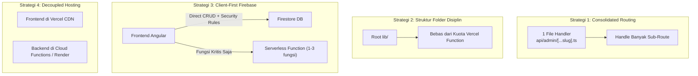

# Panduan Arsitektur: Mengoptimalkan Vercel Hobby Plan (Batas Maksimal 12 Serverless Functions)

Dokumen ini merangkum analisis teknis, akar permasalahan, dan strategi arsitektur terbaik untuk merancang backend serverless di **Vercel Hobby Plan (Gratis)** agar aplikasi dapat terus berkembang tanpa terbentur batas kuota **12 Serverless Functions**.

---

## 1. Latar Belakang & Studi Kasus BBS Genba

### Akar Permasalahan
Saat men-deploy aplikasi BBS Genba, Vercel menolak build dengan pesan kegagalan:
> `Build Failed: No more than 12 Serverless Functions can be added to a Deployment on the Hobby plan. Create a team (Pro plan) to deploy more.`

### Mengapa Terjadi?
Vercel secara default memperlakukan **setiap file `.ts`/`.js` di dalam folder `api/` dan sub-direktorinya sebagai satu Serverless Function independen**.

Sebelumnya struktur folder BBS Genba:
```text
api/
├── health.ts               (1)
├── observations.ts         (2)
├── admin/
│   ├── areas.ts            (3)
│   ├── bbs-items.ts        (4)
│   ├── members.ts          (5)
│   ├── project-items.ts    (6)
│   └── projects.ts         (7)
├── dashboard/
│   ├── cross-project.ts    (8)
│   └── stats.ts            (9)
├── findings/
│   ├── follow-up.ts        (10)
│   ├── index.ts            (11)
│   └── verify.ts           (12)
└── lib/                    <-- Helper/Utilitas Internal
    ├── auth-middleware.ts  (13) ⚠️ Dihitung function
    ├── firebase-admin.ts   (14) ⚠️ Dihitung function
    └── geofence.ts         (15) ⚠️ Dihitung function
```
**Total = 15 Serverless Functions**. Karena melebihi batas 12, seluruh proses build diblokir oleh Vercel.

---

## 2. Empat Strategi Arsitektur Menghindari Batas Kuota



---

### Strategi 1: Pola "Consolidated Route" / Dynamic Catch-All *(Paling Direkomendasikan)*

Alih-alih membuat satu file untuk setiap endpoint terpisah, kelompokkan endpoint ke dalam satu file handler menggunakan **Catch-All Route** (`[...slug].ts`).

#### Contoh Struktur File:
```text
api/
├── admin/
│   └── [...slug].ts   <-- 1 FUNGSI untuk seluruh operasi Admin
├── findings/
│   └── [...slug].ts   <-- 1 FUNGSI untuk index, follow-up, verify
└── observations.ts    <-- 1 FUNGSI untuk submisi observasi
```
*Total hanya 3 Serverless Functions dari jatah 12 fungsi.*

#### Contoh Implementasi `api/admin/[...slug].ts`:
```typescript
import type { IncomingMessage, ServerResponse } from 'http';
import { sendJson } from '../../lib/auth-middleware';

export default async function handler(req: IncomingMessage, res: ServerResponse) {
  const url = new URL(req.url || '', 'http://localhost');
  const path = url.pathname.replace('/api/admin/', ''); // misal: "projects", "members"

  switch (path) {
    case 'projects':
      return handleProjects(req, res);
    case 'members':
      return handleMembers(req, res);
    case 'areas':
      return handleAreas(req, res);
    default:
      return sendJson(res, 404, { error: 'Route admin tidak ditemukan' });
  }
}
```

> [!TIP]
> **Arsitektur Monolithic Function (1 dari 12 Kuota):**  
> Anda bahkan bisa menggunakan micro-framework seperti `Hono` atau `Express` dalam satu file `api/[[...route]].ts`. Seluruh backend (ratusan rute) akan berjalan di atas **1 Serverless Function saja**.

---

### Strategi 2: Disiplin Struktur Folder (Pemisahan Helper & Lib)

Aturan ketat Vercel:
1. **Semua file di dalam `api/` = Serverless Function**.
2. File di luar `api/` **TIDAK** dihitung sebagai function.
3. Folder di dalam `api/` yang diawali garis bawah (`_`) **TIDAK** dihitung sebagai function (contoh: `api/_lib/`).

#### Struktur Folder yang Benar:
```text
project-root/
├── api/                   <-- HANYA FILE ENDPOINT API
│   ├── observations.ts
│   └── admin.ts
├── lib/                   <-- HELPER / UTILITY (Aman dari kuota)
│   ├── auth-middleware.ts
│   ├── firebase-admin.ts
│   └── geofence.ts
├── src/                   <-- Frontend Angular
└── vercel.json
```

---

### Strategi 3: Manfaatkan Client-First Architecture (Firebase Direct)

Pada arsitektur cloud modern (khususnya Firebase / Supabase):
* **Tidak semua query butuh Serverless Function.**
* Operasi baca data (Read), filter dashboard, dan pengisian form standar bisa langsung dikerjakan dari **Angular Client ke Firestore**.
* Keamanan data dijaga menggunakan **Firestore Security Rules**:
  ```javascript
  // firestore.rules
  match /findings/{findingId} {
    allow read: if request.auth != null;
    allow create: if request.auth != null;
    allow update: if request.auth != null && 
      (request.auth.uid == resource.data.picUid || request.auth.token.role == 'supervisor');
  }
  ```

#### Kapan Wajib Menggunakan Serverless Function?
Hanya buat Serverless Function untuk hal-hal yang membutuhkan wewenang rahasia:
1. **Server-side validation anti-spoofing** (misal: validasi koordinat GPS Geofence).
2. **Operasi Admin tingkat tinggi** (misal: `auth.createUser()` atau generate master project).
3. **Pekerjaan berat server** (misal: generate PDF/Excel berukuran besar).

---

### Strategi 4: Decoupled Hosting (Pemisahan Frontend & Backend)

Jika di masa depan aplikasi berkembang menjadi sistem enterprise multi-modul:
* **Frontend**: Tetap di **Vercel** karena Vercel adalah platform hosting frontend SPA/PWA terbaik dengan Edge CDN global dan build pipeline otomatis dari GitHub.
* **Backend API**:
  * **Firebase Cloud Functions**: Terhubung langsung ke project Firebase tanpa batasan jumlah 12 function.
  * **Render.com / Railway**: Menjalankan 1 container Node.js Express/NestJS penuh secara gratis / terjangkau.

---

## 3. Checklist Sebelum Deploy Proyek Baru ke Vercel

Gunakan checklist ini sebelum melakukan `git push` pertama kali:

- [ ] **Hitung file di `api/`**: Pastikan jumlah file `.ts`/`.js` di folder `api/` maksimal **11 file** (menyisakan ruang aman).
- [ ] **Folder Helper**: Pastikan utilitas, middleware, dan DB client berada di folder `lib/` di luar `api/` (atau diawali `_`).
- [ ] **Kompilasi TypeScript**: Jalankan `npx tsc --noEmit` secara lokal untuk memastikan tidak ada error tipe data tersembunyi pada fungsi `/api`.
- [ ] **Konfigurasi `vercel.json`**:
  * Pastikan rewrite SPA tidak memblokir `/api`:
    ```json
    "rewrites": [
      { "source": "/((?!api/).*)", "destination": "/index.html" }
    ]
    ```
  * Tambahkan header no-cache untuk HTML & Service Worker agar PWA tidak terkunci cache lama.
- [ ] **Environment Variables**: Daftarkan seluruh env variables (`FIREBASE_PROJECT_ID`, `FIREBASE_CLIENT_EMAIL`, `FIREBASE_PRIVATE_KEY`) di Vercel Project Settings.
